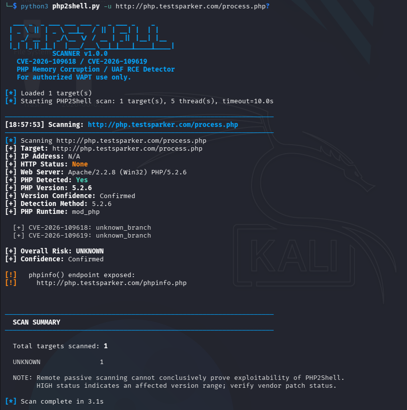
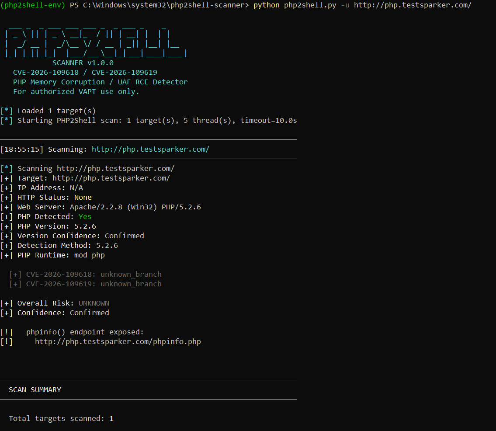

# PHP2Shell Scanner

**Version:** 1.0.0  
**CVEs Covered:** CVE-2026-109618 · CVE-2026-109619  
**CVSS v4.0:** 9.2 (Critical) for both  
**CISA KEV Added:** 2026-10-26  

---

## Overview

PHP2Shell Scanner is a **multi-method passive vulnerability detection engine** for identifying PHP environments potentially affected by two critical October 2026 Use-After-Free vulnerabilities:

| CVE | Mechanism | Fixed In |
|-----|-----------|----------|
| **CVE-2026-109618** | Upload-progress unserializer UAF — OOM handler fires mid-serialization, zval refcount drops to 0, dangling pointer survives to next worker request | 8.5.12 · 8.4.27 · 8.3.36 · 8.2.35 |
| **CVE-2026-109619** | `EG(last_fatal_error_backtrace)` retained after request heap destruction; dangling pointer + OPcache `map_ptr` type confusion in persistent workers | 8.5.12 · 8.4.27 · 8.3.36 · 8.2.35 |

Both CVEs were confirmed exploitable by Trail of Bits against PHP 8.2–8.5 running under **FPM, mod_php, LiteSpeed, and FrankenPHP** (persistent-worker architectures that maximise UAF exploitability).

> **This tool performs passive reconnaissance only.** It never sends malformed payloads, triggers memory errors, uploads files, or causes any service disruption.

---

## Screenshots

**Running on Kali Linux:**



**Running on Windows (PowerShell):**



---

## Detection Methods

The scanner runs up to five independent detection methods and merges their results through a confidence-weighted engine:

| # | Method | Max Confidence | Notes |
|---|--------|---------------|-------|
| 1 | **HTTP Header Fingerprinting** | MEDIUM | `X-Powered-By`, `Server`, `X-Generator`, `Via`, `X-PHP-Version` |
| 2 | **HTML / App Fingerprinting** | LOW | PHPSESSID cookie, PHP error pages, HTML comment version strings, CMS detection |
| 3 | **phpinfo Endpoint Detection** | HIGH | Checks 13 common paths; extracts version, Server API, `memory_limit`, `fatal_error_backtraces` |
| 4 | **Local PHP Runtime Detection** | CONFIRMED | `php --version`, package manager (apt/dpkg/rpm/brew), Windows path scan |
| 5 | **Runtime Architecture Identification** | Additive | FPM, mod_php, CGI, LiteSpeed, FrankenPHP — determines persistent-worker risk tier |

---

## Severity Classification

```
CRITICAL  = AFFECTED version + HIGH/CONFIRMED confidence + persistent-worker architecture
HIGH      = AFFECTED version + MEDIUM/HIGH confidence + any/unknown architecture
MEDIUM    = AFFECTED version + LOW confidence (header/cookie only)
LOW       = VENDOR_CHECK (PHP 8.1/8.0/7.4) or LEGACY_EOL (≤ 7.3)
NOT_VULNERABLE = version ≥ fixed release for that branch
UNKNOWN   = PHP not detected, or version not determinable
```

**Version comparison** uses `packaging.version.Version` exclusively — never string comparison. `"8.3.9" < "8.3.10"` is correct with semantic versioning.

**PHP 8.1 / 8.0 / 7.4** — Source backports only; no numbered upstream release. These return `VENDOR_CHECK` status (LOW severity) requiring distro package verification.

**PHP ≤ 7.3** — EOL with no upstream patch. `LEGACY_EOL` status (LOW severity).

---

## Installation

### Kali Linux (recommended)

```bash
# 1. Clone / extract to your tools directory
mkdir -p ~/tools && cd ~/tools
# (copy the php2shell-scanner/ folder here)

# 2. Create a virtual environment
python3 -m venv php2shell-env
source php2shell-env/bin/activate

# 3. Install dependencies
pip install -r php2shell-scanner/requirements.txt

# 4. Verify
python3 php2shell-scanner/php2shell.py --help
```

### Windows (PowerShell)

```powershell
# 1. Ensure Python 3.10+ is installed (python.org)
# 2. Open PowerShell in the php2shell-scanner directory

python -m venv php2shell-env
.\php2shell-env\Scripts\Activate.ps1
pip install -r requirements.txt
python php2shell.py --help
```

### Quick one-liner (no venv)

```bash
pip install --break-system-packages requests colorama packaging urllib3
python3 php2shell.py --help
```

---

## Usage

### Single target

```bash
python3 php2shell.py -u https://target.example.com
```

### Target list

```bash
python3 php2shell.py -l targets.txt --threads 10
```

### Full scan with phpinfo probe + local detection

```bash
python3 php2shell.py -u https://target.example.com --check-phpinfo --local -v
```

### Generate VAPT reports (all three formats)

```bash
python3 php2shell.py -l targets.txt \
    --threads 10 \
    --timeout 15 \
    --check-phpinfo \
    --format json \
    -o scan_results.json

python3 php2shell.py -l targets.txt --format csv  -o scan_results.csv
python3 php2shell.py -l targets.txt --format html -o scan_report.html
```

### Scan through a proxy (e.g. Burp Suite)

```bash
python3 php2shell.py -u https://target.example.com \
    --proxy http://127.0.0.1:8080 \
    --no-ssl-verify
```

### Custom headers and User-Agent

```bash
python3 php2shell.py -u https://target.example.com \
    --user-agent "Mozilla/5.0 (Penetration Test)" \
    --headers "Authorization: Bearer TOKEN" "X-Custom: value"
```

### Scan on a non-standard port

```bash
python3 php2shell.py -u https://target.example.com --port 8443
```

---

## All CLI Flags

```
Target selection:
  -u, --url URL             Single target URL
  -l, --list FILE           File containing one URL per line

HTTP options:
  --threads N               Concurrent scan threads (default: 5)
  --timeout SECS            Per-request timeout in seconds (default: 10)
  --retries N               Max retries on transient failure (default: 2)
  --delay SECS              Delay between requests per thread (default: 0)
  --proxy URL               HTTP/HTTPS proxy (e.g. http://127.0.0.1:8080)
  --no-ssl-verify           Disable SSL certificate verification
  --user-agent UA           Custom User-Agent string
  --headers K:V [K:V ...]   Extra request headers
  --port PORT               Override destination port

Detection:
  --check-phpinfo           Probe common phpinfo paths (default: on)
  --no-phpinfo              Disable phpinfo probing
  --local                   Include local PHP binary / package manager detection

Output:
  -o, --output FILE         Write report to this file
  --format {json,csv,html}  Report format (default: json)

Verbosity:
  -v, --verbose             Show per-target evidence details
  -q, --quiet               Suppress all output except errors
  --debug                   Enable debug logging
```

---

## Exit Codes

| Code | Meaning |
|------|---------|
| `0` | Scan completed; no CRITICAL or HIGH findings |
| `1` | Scan error (bad input, all targets failed) |
| `2` | CRITICAL or HIGH vulnerability found on at least one target |

Exit code 2 makes the scanner suitable for CI/CD pipeline integration.

---

## Running Tests

```bash
cd php2shell-scanner
pip install pytest
pytest tests/ -v
```

Expected output: all tests pass. The test suite covers:
- All PHP version branches (8.5/8.4/8.3/8.2 affected+fixed, 8.1/7.4 vendor_check, 7.3/5.6 legacy_eol)
- `packaging.version` ordering correctness (never string comparison)
- Confidence tier assignment per signal type
- Fingerprint version-source priority (local > phpinfo > header > html)
- Version conflict detection
- End-to-end classification pipeline (CRITICAL → UNKNOWN)

---

## Project Structure

```
php2shell-scanner/
├── php2shell.py                  # CLI entry point
├── requirements.txt
├── config/
│   └── vulnerability_db.json     # CVE metadata, PHP branch data
├── core/
│   ├── version_check.py          # Semantic version comparison (packaging.version)
│   ├── http_client.py            # Hardened GET-only requests.Session
│   ├── confidence.py             # Confidence tier engine + signal weights
│   ├── fingerprint.py            # Multi-source fingerprint aggregator
│   ├── vulnerability_engine.py   # CRITICAL/HIGH/MEDIUM/LOW classification
│   └── scanner.py                # Concurrent scan orchestrator
├── detectors/
│   ├── header_detector.py        # HTTP response header analysis
│   ├── html_detector.py          # HTML body + cookie analysis
│   ├── phpinfo_detector.py       # phpinfo endpoint probing
│   └── local_detector.py        # Local PHP binary / package manager
├── reporters/
│   ├── json_report.py
│   ├── csv_report.py
│   └── html_report.py            # Self-contained VAPT HTML report
└── tests/
    ├── test_version_check.py
    ├── test_vulnerability_engine.py
    ├── test_fingerprint.py
    └── test_classification.py
```

---

## Known Limitations and Assessment Caveats

1. **Passive detection only.** The scanner reads headers and probes phpinfo endpoints. It cannot confirm in-memory conditions (heap layout, refcount values, OPcache state) that determine whether a UAF is actually exploitable on a specific request.

2. **Header suppression.** Many production environments suppress or spoof `X-Powered-By` and `Server` headers. A `NOT_VULNERABLE` or `UNKNOWN` result does not rule out a vulnerable PHP installation.

3. **Reverse proxy / CDN masking.** PHP version headers may reflect the CDN edge, not the origin server. Corroborate with phpinfo probing or local detection when possible.

4. **Vendor backport ambiguity.** PHP 8.1, 8.0, and 7.4 have no numbered upstream fix release. Distro vendors (Debian, Ubuntu, RHEL, etc.) may have applied source backports. The scanner reports `VENDOR_CHECK` (LOW severity) for these branches; always verify with `apt-cache policy php*` or `rpm -q php`.

5. **phpinfo exposure is itself a finding.** A publicly accessible phpinfo page at any of the 13 probed paths represents an information disclosure vulnerability regardless of PHP version. Restrict access or remove these files.

6. **CVE-2026-109619 mitigation (`fatal_error_backtraces=0`)** is only available in PHP 8.5. The scanner reports whether this mitigation is detected via phpinfo; it does not verify php.ini on disk.

---

## Legal Disclaimer

This tool is designed for **authorized security assessments only**. Use it only on systems you own or have explicit written permission to test. Unauthorized scanning may violate the Computer Fraud and Abuse Act (CFAA), the Computer Misuse Act, or equivalent laws in your jurisdiction.

---

## References

- [PHP Security Advisory — October 2026](https://www.php.net/security/)
- [CISA Known Exploited Vulnerabilities Catalog](https://www.cisa.gov/known-exploited-vulnerabilities-catalog)
- [Trail of Bits PHP UAF Research](https://blog.trailofbits.com/)
- [NVD CVE-2026-109618](https://nvd.nist.gov/vuln/detail/CVE-2026-109618)
- [NVD CVE-2026-109619](https://nvd.nist.gov/vuln/detail/CVE-2026-109619)
